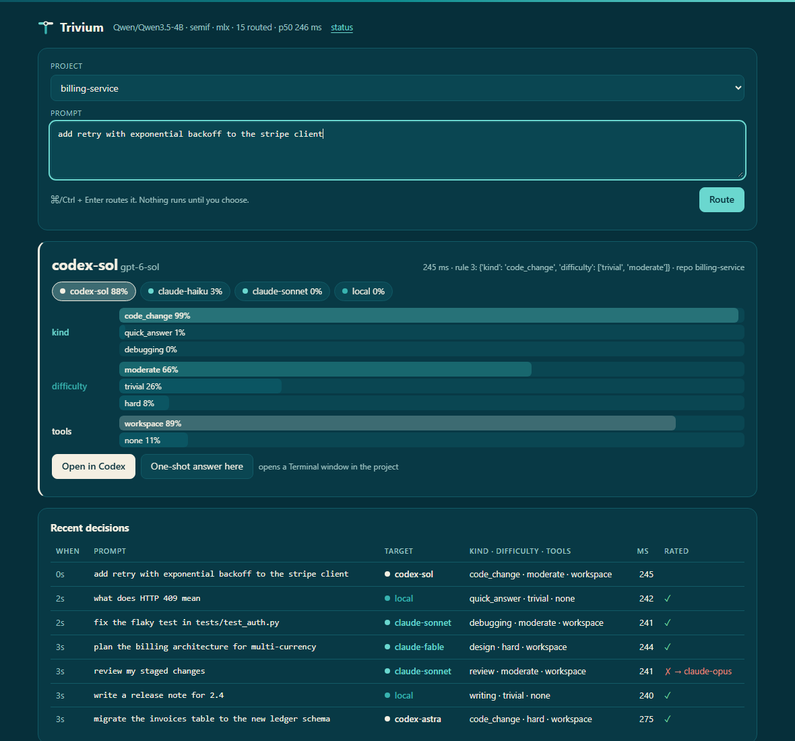

<p align="center"></p>

<h1 align="center">Trivium</h1>

<p align="center">
  <!-- CI -->
  <a href="https://github.com/7ucardie/trivium/actions/workflows/test.yml">
    
  </a>
  <!-- Version -->
  <a href="https://github.com/7ucardie/trivium/releases">
    
  </a>
  <!-- License -->
  <a href="https://github.com/7ucardie/trivium/blob/main/LICENSE">
    
  </a>
  <!-- Docs -->
  <a href="https://diataxis.fr/">
    
  </a>
</p>
<p align="center">
  <!-- Where Trivium sends a prompt; see docs/explanation/how-trivium-works.md -->
  <a href="docs/explanation/how-trivium-works.md#default-routing">
    
  </a>
  <a href="docs/explanation/how-trivium-works.md#default-routing">
    
  </a>
  <a href="docs/explanation/how-trivium-works.md#default-routing">
    
  </a>
</p>
<p align="center">
  <!-- Issues -->
  <a href="https://github.com/7ucardie/trivium/issues">
    
  </a>
  <!-- Stars -->
  <a href="https://github.com/7ucardie/trivium/stargazers">
    
  </a>
  <!-- Forks -->
  <a href="https://github.com/7ucardie/trivium/network">
    
  </a>
</p>
<p align="center">
  <!-- Stack -->
  
  
  
  
  
</p>

A local System-1 router that sends each prompt to the right model: a local Qwen, Claude Code, or Codex.

*Trivium* is Latin for the place where three roads meet. You type one command; a small model on your
own machine reads the prompt in about a quarter of a second, and the prompt goes down one of three
roads: answered locally, opened in Claude Code, or opened in Codex, on the model tier the task needs.

```text
$ ask why "add retry with exponential backoff to the http client in server.py"
→ codex-sol (gpt-6-sol) · code_change/trivial/workspace · 258 ms · rule 3
  kind       code_change=1.00  quick_answer=0.00  design=0.00  debugging=0.00  review=0.00  writing=0.00
  difficulty trivial=0.78  moderate=0.22  hard=0.00
  tools      workspace=0.99  none=0.01

$ ask -p "what does HTTP 409 mean"
→ local (Qwen/Qwen3.5-4B) · quick_answer/trivial/none · 258 ms · rule 1
**HTTP 409 Conflict** is a server response status code indicating ...
```

<p align="center"></p>
<p align="center"><sub>Demo data, dark theme.</sub></p>

## What it does

- **Routes across vendors:** one command in front of Claude Code, Codex and a local model, so a prompt can reach Opus, GPT or neither.
- **Decides before any tokens are spent:** one forward pass of a local Qwen3.5-4B, about a quarter of a second. No hosted call reads your prompt until the chosen tool does.
- **Asks three typed questions:** `kind`, `difficulty` and `tools`, each with a probability per option. No text is generated, so there is nothing to parse.
- **Maps answers to a target with rules:** a first-match-wins table in `targets.yaml`. A new model is a config edit.
- **Answers trivial questions itself:** the Qwen that routed the prompt also answers it, so one model in memory does both jobs.
- **Keeps your setup:** it launches the real `claude` and `codex` CLIs, so logins, subscriptions, settings, skills and MCP servers work as they already do.
- **Stays open as a terminal app:** type a prompt, see where it would go, and act on it with one key.
- **Has a web dashboard and a JSON API:** the same flow in the browser on 127.0.0.1, token-protected, for embedding in another dashboard.
- **Lets you overrule it:** `--ask` to pick from the likeliest targets, `--to` to skip the router, `--via` to swap the vendor.
- **Logs every decision:** with full probabilities and your rating, ready to export as labelled prompts.
- **Measures itself:** `ask eval`, `ask calibrate` and three bundled labelled sets show how often the router picks the right target.
- **Runs on three runtimes:** MLX on Apple Silicon (default), PyTorch on CUDA or MPS, or llama.cpp on any CPU.

The router runs on your machine. Your prompt only leaves it through the tool it is sent to.

## Install

You need:

- One of three runtimes for the Qwen3.5-4B router (`router.runtime`):
  - `mlx` (default): macOS on Apple Silicon, about 9 GB of free memory in bf16, less with `bits: 8`.
  - `torch`: a CUDA GPU with about 9 GB of memory, or an Apple GPU through MPS.
  - `llamacpp`: any CPU, from a 2.9 GB 4-bit GGUF file. It decides only, so local targets go to Claude.
- [uv](https://docs.astral.sh/uv/) and Python 3.10–3.13.
- The [Claude Code](https://code.claude.com) and/or [Codex](https://github.com/openai/codex) CLIs,
  logged in, for the targets you want to use.

**From source:**

```sh
git clone https://github.com/7ucardie/trivium && cd trivium
uv sync                    # MLX and the vendored semif readout; no PyTorch needed
# or: uv sync --extra torch     (CUDA / MPS)    uv sync --extra llamacpp   (CPU, builds llama.cpp)
uv tool install -e .       # puts `ask` (and `trivium`) on your PATH
ask serve                  # keep the router warm; the first run downloads Qwen3.5-4B (~9 GB)
```

For the `torch` or `llamacpp` runtime, set `router.runtime` in your config (see
[Configuration](docs/reference/configuration.md)). The `llamacpp` runtime downloads the pinned
`bartowski/Qwen_Qwen3.5-4B-GGUF` Q4_K_M file on first use, or reads a local file from `router.gguf`.

`ask` works without `ask serve`, but then it loads the model for every prompt, which takes several
seconds. `ask service install` starts the server at every login. On Windows, follow
[Run on Windows](docs/how-to/run-on-windows.md).

## Use

```sh
trivium                                          # the terminal app: type prompts, act with one key
ask "fix the flaky test in tests/test_auth.py"   # route, then open an interactive session
ask -p "regex for a semver string"               # one-shot: print the answer and exit
ask why "plan the billing architecture"          # show the decision and probabilities only
ask --to opus "..."                              # skip the router: target, short name or model id
ask serve                                        # keep the router warm; dashboard at http://127.0.0.1:8765/
```

Every command and flag is in the [CLI reference](docs/reference/cli.md).

## Documentation

The docs follow [Diátaxis](https://diataxis.fr/); start at [docs/README.md](docs/README.md).

- **Tutorial:** [Getting started](docs/tutorials/getting-started.md)
- **How-to:** [Use the terminal app](docs/how-to/terminal-app.md) · [Use the web dashboard](docs/how-to/web-dashboard.md) · [Measure and improve the router](docs/how-to/measure-the-router.md) · [Calibrate the router](docs/how-to/calibrate.md) · [Run on Windows](docs/how-to/run-on-windows.md)
- **Reference:** [CLI](docs/reference/cli.md) · [Configuration](docs/reference/configuration.md) · [Runtimes and backends](docs/reference/runtimes-and-backends.md) · [JSON API](docs/reference/api.md) · [Status and limits](docs/reference/stability.md)
- **Explanation:** [How Trivium works](docs/explanation/how-trivium-works.md)

## Roadmap

Trivium is early: it works end to end on the author's machine, and interfaces and defaults will change.
The current limits are in [Status and limits](docs/reference/stability.md).

**Next:** more labelled prompts. Calibration is fitted on 72 prompts and checked on 28, and the option weights ship off because their gain was not significant on 119.

**Later:**

- **A trained router:** the decision log is the data for training one.
- **`torch` on a CUDA GPU:** tested on Apple MPS only.
- **`ask service` on Linux:** it uses launchd on macOS and a scheduled task on Windows.

**Not planned:**

- **Routing per turn:** routing happens once per task. Once a session is open you stay in that tool.

## License

Trivium is released under the [MIT License](LICENSE). It builds on:

- [semif](https://github.com/theoleecj/semif) (MIT) for option-logit scoring, vendored unchanged in
  `src/trivium/_semif` at commit 1f2dea3 with its license, because PyPI does not allow git dependencies
- [Qwen3.5-4B](https://huggingface.co/Qwen/Qwen3.5-4B) (Apache 2.0), downloaded at run time, not
  redistributed
- [MLX](https://github.com/ml-explore/mlx) and [mlx-lm](https://github.com/ml-explore/mlx-lm) (MIT)
- [Laya](https://huggingface.co/convaiinnovations/laya) (Apache 2.0), optional; weights pinned by revision

Claude, Claude Code, Codex and the model names are trademarks of their owners. Trivium is an
independent project and is not affiliated with Anthropic or OpenAI.
